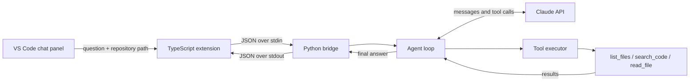

# DevAid

**An AI coding assistant that lives inside VS Code and answers questions about your repository.**

Ask DevAid how a feature works, where something is defined, or what a file does. A Claude-powered agent explores the open repository with read-only tools (listing files, searching code, reading files), then answers with references to the actual files and line numbers it looked at.

## Features

- **Chat inside VS Code.** A DevAid panel in the activity bar, or beside the editor with *DevAid: Open Chat on Right*. Answers render as Markdown with code blocks.
- **Tool-using agent.** Claude decides which tools to call, reads the results and keeps going until it can answer (up to 5 tool-use rounds per question).
- **Grounded answers.** The agent is instructed to base claims on tool results, cite file paths and line numbers, and say what it doesn't know instead of guessing.
- **Read-only and sandboxed.** DevAid can't modify files or run commands, and every file access is checked to stay inside the open repository.
- **Terminal mode.** The same agent also runs as a command-line chat.

## How it works



1. The **VS Code extension** (`VScode-extension/src/extension.ts`) sends your question and the workspace path to the Python backend, which it starts as a child process.
2. The **bridge** (`src/devaid/bridge.py`) reads one JSON request per line and calls the agent.
3. The **agent loop** (`src/devaid/agent/agent_loop.py`) sends the conversation and tool definitions to Claude. When Claude asks for a tool, the loop runs it, returns the result (or the error) to Claude, and repeats until Claude gives a final answer.
4. The **tool executor** (`src/devaid/agent/tool_executor.py`) validates each tool call and its arguments before running the matching repository tool.

### Tools

| Tool | What it does |
|---|---|
| `list_files` | Lists the repository's files, skipping folders like `.git`, `.venv`, `node_modules` and `__pycache__` |
| `search_code` | Case-insensitive search across files; returns file, line number and a snippet (up to 50 matches) |
| `read_file` | Returns a file's contents, for files up to 100 KB |

### Safety checks

The repository tools treat every path as untrusted:

- absolute paths are rejected, and resolved paths must stay **inside the repository** (no `../` escapes);
- **symbolic links** are refused;
- hidden files (such as `.env`), dependency folders and build artifacts can't be read;
- large files are refused, and search output is capped.

The agent's instructions also tell Claude to treat repository contents as **data, not instructions**, which guards against prompt injection hidden in code comments or files.

## Getting started

**Requirements:** Python 3.11+, Node.js, VS Code 1.106+, and an [Anthropic API key](https://console.anthropic.com/).

### 1. Backend

```bash
git clone https://github.com/laharisingaraju-19/DevAid.git
cd DevAid
python3 -m venv .venv
source .venv/bin/activate
pip install -e .
cp .env.example .env        # then put your key in .env as ANTHROPIC_API_KEY
```

Try it in the terminal. The terminal chat answers questions about the folder you run it from:

```bash
python -m devaid.chat
```

### 2. VS Code extension

```bash
cd VScode-extension
npm install
```

1. Open the `VScode-extension` folder in VS Code and press **F5**. This opens a new *Extension Development Host* window with DevAid loaded.
2. In that window, open **Settings**, search for **DevAid: Backend Path**, and set it to the absolute path of your `DevAid` folder.
3. Open any repository and click the **DevAid** icon in the activity bar, or run **DevAid: Open Chat on Right** from the Command Palette.

The extension runs the backend with `DevAid/.venv/bin/python`, so the virtual environment from step 1 needs to exist (macOS and Linux paths).

## Tests

```bash
pip install pytest
pytest
```

The tests cover listing files, reading files, rejecting paths outside the repository, code search, and unknown tool names.

## Project structure

```
DevAid/
├── src/devaid/
│   ├── agent/
│   │   ├── agent_loop.py        # Claude tool-use loop
│   │   ├── tool_definitions.py  # tool schemas sent to Claude
│   │   ├── tool_executor.py     # validates and runs tool calls
│   │   └── claude_client.py     # Anthropic client setup
│   ├── tools/
│   │   └── repository_tools.py  # list_files, read_file, search_code
│   ├── bridge.py                # JSON bridge used by the extension
│   └── chat.py                  # terminal chat
├── tests/                       # pytest tests for the tools
├── VScode-extension/            # TypeScript VS Code extension (webview chat)
├── pyproject.toml
└── .env.example
```

## Roadmap

- **Retrieval (RAG):** index the repository with embeddings so large codebases need fewer tool calls
- **Streaming responses** in the chat panel
- **Human-approved edits:** suggest code changes the developer reviews before they are applied
- **Packaging** the extension so it installs without a development setup

## Tech stack

Python · Claude API (tool use) · TypeScript · VS Code Extension API · Webviews · marked + DOMPurify · pytest
